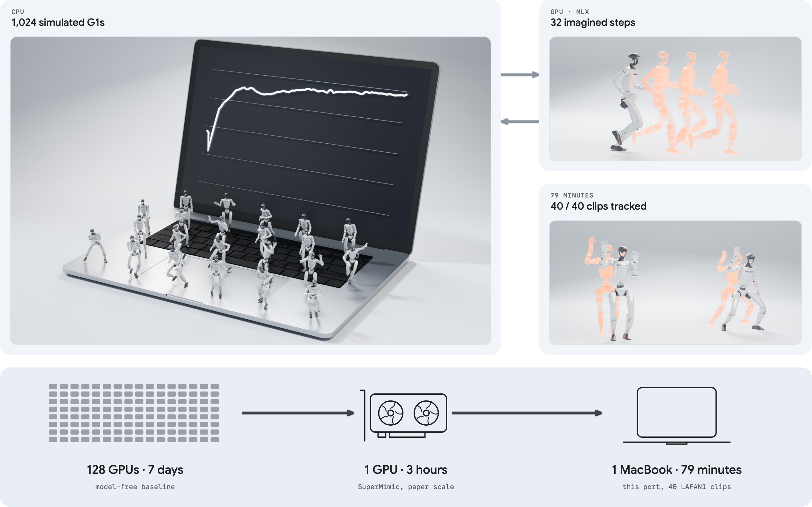

<p align="center">
  <picture>
    <source media="(prefers-color-scheme: dark)" srcset="figures/logo-dark.svg">
    
  </picture>
</p>

<p align="center"><b>Train a whole-body motion tracker for the Unitree G1 on your laptop.</b><br>40 motions, one MacBook, 79 minutes.</p>

M1mic-MLX learns a world model of the robot and improves the policy by backpropagating through rollouts imagined in
that model. MuJoCo's C engine steps the simulated robots on the CPU cores, and the world model, policy and critic
train in [MLX](https://github.com/ml-explore/mlx) on the GPU. No NVIDIA stack, no cloud.

<p align="center"></p>

On an M1 Pro with 16 GB, one policy tracks all 40 LAFAN1 clips after **79 minutes** of training, using 2.6 GB of memory.

## Setup

macOS on Apple silicon, Python 3.11 to 3.13.

```bash
python3 -m venv .venv && source .venv/bin/activate
pip install -r requirements.txt
bash tools/download_data.sh    # LAFAN1 clips retargeted to the G1, and the G1 meshes
```

## Use

```bash
python train.py --log_dir runs/lafan1                 # all 40 clips; --clips walk,run trains on a subset
python -m m1mic.evaluate runs/lafan1             # writes runs/lafan1/eval_mlx.csv
python tools/rollout.py runs/lafan1/ckpt_003500.npz --clip dance1_subject2 --start 60 --out rollout.npz
python tools/render_rollout.py rollout.npz --out rollout.gif
```

Every field of [`m1mic/config.py`](m1mic/config.py) is a flag of `train.py`. `--max_minutes 120` stops a run
on a time budget. Logs go to `train_log.csv` and to TensorBoard event files in the run directory.

Run one training or evaluation at a time on a 16 GB machine. Two MLX processes side by side will push it into swap.

## Results

`results/m1pro_lafan1_2h` is a run with the default options and a 120-minute budget on an M1 Pro (8 cores, 16 GB):
4,877 iterations at about 0.7 per second. The target is the one XMimic and BlinkMimic use: a normalized return of at
least 0.82 with none of the 40 clips failing, held for three checkpoints in a row.

| iteration | training (min) | return | failed clips |
|---|---|---|---|
| 1,000 | 24 | 0.624 | 14 |
| 2,000 | 52 | 0.732 | 8 |
| 3,000 | 79 | 0.824 | 0 |
| 3,500 | 92 | 0.830 | 0 |
| 4,000 | 102 | 0.832 | 0 |
| 4,500 | 112 | 0.834 | 0 |
| 4,750 | 117 | 0.833 | 0 |

This is one run on one machine. Numbers from other Macs are welcome.

## Where it comes from

M1mic-MLX is the laptop end of a line of work that kept making humanoid motion tracking cheaper to train. It takes
something from each step:

| work | what it showed | what M1mic-MLX takes from it |
|---|---|---|
| [SuperMimic](https://arxiv.org/abs/2610.28480) | One differentiable world model replaces model-free RL: 3 hours on one GPU instead of 7 days on 128 | The method, and the velocity-command task (`--vel_share`) |
| [InstantTrack](https://github.com/Huy-Quang-Dao/instantTrack), from [supermimic_vibed](https://github.com/zita-ch/supermimic_vibed) | An open implementation that trains in minutes | The code base the later trainers grew from |
| [BlinkMimic](https://arxiv.org/abs/2611.16422) | About 3 minutes on one GPU | The training recipe and hyperparameters (`PRESET[main]`), the probe sweeps, the evaluation protocol |
| [XMimic](https://github.com/nico-bohlinger/xmimic) | Under a minute on four H100s, in JAX | The functional structure of the code and the checkpoint format |

The numerics were checked function by function against a JAX reference in float32, including the losses and
gradients of the world-model update and of the policy's backpropagation through imagined rollouts. They agree to 1e-5.
For scale, XMimic reaches the same target in 2.5 minutes on one H100, so the laptop is about 30 times slower.

## What is new here

Getting this onto a laptop is not a change of backend. A Mac has no GPU simulator, shared memory instead of VRAM, and
a GPU that is slow at things a data-center card does not notice.

- **Physics on the CPU.** A thread pool steps the worlds with `mj_step`, about 22,000 control steps per second on 8
  cores. Each world has its own friction and CoM offset and keeps its solver warm start. The threads use a copy of the
  model with the meshes reduced to their convex hulls (15 MB instead of 75 MB, same dynamics).
- **Math written for Metal.** 3x3 products are fused column-row sums with their own gradients, and reductions over
  inner axes are avoided. Both are several times faster on Apple GPUs than the obvious form.
- **Sized for 16 GB.** The defaults are a quarter of the published batch dimensions: 1024 worlds, world-model and
  policy batches of 512, at most 384 probe worlds. The ratios are unchanged. The published size is
  `--num_envs 4096 --wm_batch 2048 --pi_batch 2048 --eprobe_max 1536`.
- **Memory.** MLX's cache of freed GPU buffers is capped (`--cache_gb`, default 1). Its default is nearly all of the
  memory, and a 16 GB Mac then swaps. The replay buffer is numpy, since host and GPU share memory.
- **Reference tables.** The motion library precomputes velocities, body poses and goal features per frame when they
  fit in 2 GB, and derives them on demand otherwise.
- **Guards.** `mlx.nn.elu` has a NaN gradient above x = 88, which froze a run, so the networks use their own ELU.
  World-model and critic steps with a non-finite loss are skipped.
- **float32.** Apple GPUs have no bf16. float16 matmuls were 15 % faster and not worth the precision.
- **Evaluation.** One world per checkpoint and clip. The CPU simulator is deterministic, so replicas would be identical.
- **Velocity commands.** The RL training of SuperMimic's velocity encoder is not in its released code. It is
  implemented here from the paper.

## Citation

If you use M1mic-MLX, please cite the work it builds on:

```bibtex
@misc{liao2026supermimic,
  title = {SuperMimic: Scaling Humanoid Whole-Body Control with One Differentiable World Model},
  note  = {arXiv:2610.28480},
  year  = {2026}
}
@misc{chen2026blinkmimic,
  title  = {BlinkMimic: Training a Humanoid Motion Tracker in Minutes on a Single GPU},
  author = {Chen, Fuyi},
  note   = {arXiv:2611.16422},
  year   = {2026}
}
@misc{bohlinger2026xmimicxsoma,
  title  = {XMimic and XSoma: Learning Humanoid Motion Tracking and Locomotion in Under a Minute},
  author = {Bohlinger, Nico and Peters, Jan},
  year   = {2026},
  url    = {https://nico-bohlinger.github.io/papers/2026_xmimic_xsoma.pdf}
}
```

## License

MIT, see [LICENSE](LICENSE). The code this derives from is listed in [THIRD_PARTY_NOTICES.md](THIRD_PARTY_NOTICES.md).
The LAFAN1 motions are not part of the repository. Anything derived from them, including trained checkpoints and the
figure above, is under CC BY-NC-ND 4.0: non-commercial use only.
